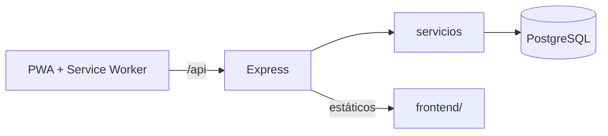

# Rodando UTP

PWA para que estudiantes de la Universidad Tecnológica de Puebla compartan raite (carpooling) hacia el campus: rutas en un mapa ilustrado, horarios, reservaciones con código, calculadora de ahorro y panel de conductor con CRUD de raites. Funciona sin conexión para la parte estática y degrada con elegancia cuando la API no responde. Incluye un [laboratorio de caché](#laboratorio-de-caché-cache-storage-api) que demuestra la Cache Storage API en vivo.

- **Frontend:** HTML/CSS/JS vanilla (`frontend/`), servido por Express.
- **Backend:** Node.js 20 + Express 4 (ES modules) con validación zod, JWT y bcrypt.
- **Base de datos:** PostgreSQL 16.
- **Despliegue:** un contenedor Docker (Render con `render.yaml`).

## Arquitectura



Detalle en [docs/arquitectura.md](docs/arquitectura.md), [docs/modelo-datos.md](docs/modelo-datos.md) y [docs/endpoints.md](docs/endpoints.md).

## Cómo correr en local

### Con Docker (recomendado)

```bash
docker compose up --build
```

Abre http://localhost:3000 (API en `/api`, documentación en http://localhost:3000/api/docs). Las migraciones y el seed se ejecutan solos al iniciar y son idempotentes. Los datos persisten en el volumen `pgdata`.

### Sin Docker

```bash
cd backend
npm install
cp ../.env.example .env        # ajusta DATABASE_URL a tu Postgres
npm start                      # migra, siembra y sirve en :3000
```

## Cuentas de demostración

El seed crea un administrador y 9 conductores. Contraseña de demo (solo para desarrollo, configurable con `SEED_PASSWORD`): `Demo1234!`

| Rol | Correo |
|---|---|
| Admin | `admin@utpuebla.edu.mx` |
| Conductor | `mariana.lopez@utpuebla.edu.mx` (y otros 8) |

Cualquier persona puede crear una cuenta de pasajero o conductor con un correo `@utpuebla.edu.mx`.

## Panel CRUD

`/panel.html` (enlace «Mi panel» en el menú): un conductor inicia sesión y puede **agregar, editar, pausar y eliminar** sus raites. Usa `GET /api/raites/mios`, `POST/PATCH/DELETE /api/raites`.

## Panel de administración (más CRUDs, con actualización en vivo)

`/admin.html` (solo `admin@utpuebla.edu.mx`): pestañas con **CRUD de zonas, testimonios y FAQ**, gestión de **usuarios** (cambiar rol, eliminar), edición y borrado de **raites**, **reservas** (cancelar) y **solicitudes** de conductor (aprobar). La información se refresca sola cada 4 segundos, así que los cambios hechos desde otra pestaña o desde la app aparecen sin recargar (indicador «En vivo» arriba).

## Caché de la API

Las lecturas públicas (`/zonas`, `/raites`, `/testimonios`, `/faq`, `/config`, `/stats`) se guardan en una **caché en memoria** del servidor (`middlewares/cache.js`) con TTL (5 min catálogos, 15 s raites, 30 s stats).

- Cada respuesta lleva `X-Cache: MISS` (calculada y guardada) o `X-Cache: HIT` (servida de memoria, con cabecera `Age`).
- Cualquier escritura exitosa (crear/editar/borrar raites, reservar, cancelar, CRUD de admin) **vacía la caché**, por lo que no se muestran lugares libres desactualizados.
- `ETag` + `Cache-Control: no-cache`: el navegador revalida y recibe **304 Not Modified** sin cuerpo si no hubo cambios.
- `GET /api/cache/stats` muestra entradas, hits, misses y % de aciertos; `DELETE /api/cache` (admin) la vacía.

Demostración rápida:

```bash
curl -si localhost:3000/api/zonas | grep -i x-cache     # X-Cache: MISS
curl -si localhost:3000/api/zonas | grep -i "x-cache\|age"   # X-Cache: HIT
curl -s  localhost:3000/api/cache/stats                  # {"entradas":1,"hits":1,"misses":1,...}
```

## Laboratorio de caché (Cache Storage API)

`/cache.html` (enlace «Caché» en el menú): página que ejecuta en vivo los métodos de la **Cache API** sobre las cachés reales del navegador y registra cada llamada en una bitácora.

- **`caches.*`** — `keys()` para listar cachés, `open()` para crear/abrir, `has()` para comprobar y `delete()` para borrar la caché completa.
- **`cache.*`** — `keys()` para enumerar entradas (URL, tipo y tamaño), `match()` / `matchAll()` para leer, `add()` / `addAll()` para descargar y guardar, `put()` para guardar una `Response` propia y `delete()` para borrar una entrada.
- Muestra el estado del service worker y la cuota con `navigator.storage.estimate()`.
- Botón **Demostración automática**: ejecuta `caches.open()` → `cache.put()` → `cache.match()` → `cache.add()` → `cache.delete()` → `caches.has()` y lo va escribiendo en la bitácora. `cache.html?demo=1` la ejecuta sola (útil para capturas).

El laboratorio usa la misma caché versionada que el service worker (`rodando-utp-v3`), así que también sirve para ver qué quedó guardado para el modo sin conexión.

## Documento de la actividad

[`docs/api-cache/API_Cache_PWA_Rodando_UTP.docx`](docs/api-cache/API_Cache_PWA_Rodando_UTP.docx) (APA 7): qué es la caché en una PWA, cómo funciona, tabla de métodos de la Cache Storage API, implementación en el proyecto y evidencias. Se regenera con `python3 docs/api-cache/generar_doc_api_cache.py` (requiere `python-docx`; las capturas están en `docs/api-cache/img/`).

## Ver la base de datos (Adminer)

`docker compose up` también levanta **Adminer** en http://localhost:8080 (sistema PostgreSQL, servidor `db`, usuario `rodando`, contraseña `rodando`, base `rodando`). Desde ahí se ven y editan las tablas visualmente; el panel de administración y Adminer muestran los mismos datos.

## Variables de entorno

Ver [.env.example](.env.example).

| Variable | Descripción | Por defecto |
|---|---|---|
| `PORT` | Puerto HTTP | 3000 |
| `DATABASE_URL` | Cadena de conexión a Postgres | local |
| `DATABASE_SSL` | SSL a Postgres | `true` solo en producción |
| `JWT_SECRET` | Secreto de los tokens (**obligatorio en producción**) | solo desarrollo |
| `ALLOWED_ORIGINS` | Orígenes CORS separados por coma | vacío (mismo origen) |
| `VAPID_PUBLIC_KEY` / `VAPID_PRIVATE_KEY` | Llaves de push (`npx web-push generate-vapid-keys`) | vacío (push desactivado) |
| `SEED_PASSWORD` | Contraseña de las cuentas de demo | `Demo1234!` |

## Endpoints principales

| | |
|---|---|
| `GET /api/health` | Estado y base de datos |
| `POST /api/auth/registro` · `/login` · `GET /auth/me` | Cuentas |
| `GET /api/zonas` · `/raites` · `/testimonios` · `/faq` · `/config` · `/stats` | Consulta |
| `POST/PATCH/DELETE /api/raites` | CRUD del conductor |
| `POST /api/reservas` · `GET /reservas/mias` · `DELETE /reservas/:codigo` | Reservaciones |
| `POST /api/calculadora` | Calculadora de ahorro |
| `POST /api/conductores/solicitud` · `/api/admin/solicitudes` | Alta de conductores |
| `/api/push/*` | Notificaciones push |

Tabla completa en [docs/endpoints.md](docs/endpoints.md).

## Pruebas

```bash
# Necesita un Postgres con una base cuyo nombre termine en _test (se reinicia en cada corrida)
docker run -d --rm --name pg-test -e POSTGRES_USER=rodando -e POSTGRES_PASSWORD=rodando \
  -e POSTGRES_DB=rodando_test -p 55432:5432 postgres:16-alpine
cd backend && npm test          # vitest + supertest (39 pruebas)
npm run lint
```

Cubren health, zonas, raites con filtros y CRUD, registro/login, reservas (incluida concurrencia sin sobreventa), calculadora, solicitudes de conductor y push. Otra base: `TEST_DATABASE_URL=...`.

## Despliegue en Render (gratis)

1. Sube este repositorio a GitHub.
2. En [Render](https://render.com): **New → Blueprint**, elige el repositorio y confirma. Render lee `render.yaml` y crea el Web Service Docker `rodando-utp` y la base `rodando-db`.
3. `DATABASE_URL` se enlaza sola y `JWT_SECRET` se genera. Opcional: llena `VAPID_PUBLIC_KEY` y `VAPID_PRIVATE_KEY` para activar push, y `ALLOWED_ORIGINS` solo si el frontend vive en otro dominio.
4. Espera el primer despliegue. Las migraciones y el seed corren al arrancar. La URL queda como `https://rodando-utp.onrender.com`.
5. Logs: servicio → pestaña **Logs**. Estado: `/api/health`.

Notas: el plan free duerme el servicio tras ~15 min sin tráfico (la primera visita tarda en despertar) y la base free de Render caduca a los 30 días. En producción la conexión a Postgres usa SSL (`rejectUnauthorized: false`).

## Decisiones

- El frontend se mantiene en vanilla JS y se sirve desde Express para un solo contenedor.
- Apartar lugar requiere cuenta; la lectura de rutas y horarios es pública.
- Las cifras del hero parten de una base configurable (`config.stats_*`) más los usuarios reales.
- Para el diseño se usa una paleta violeta/turquesa en lugar de la amarilla/azul original.

## Créditos

Proyecto académico · Aplicaciones Web Progresivas · Universidad Tecnológica de Puebla.
