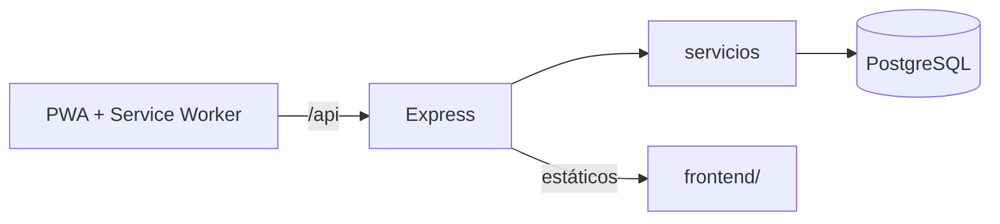

# Rodando UTP

PWA para que estudiantes de la Universidad Tecnológica de Puebla compartan raite (carpooling) hacia el campus: rutas en un mapa ilustrado, horarios, reservaciones con código, calculadora de ahorro y panel de conductor con CRUD de raites. Funciona sin conexión para la parte estática y degrada con elegancia cuando la API no responde.

- **Frontend:** HTML/CSS/JS vanilla (`frontend/`), servido por Express.
- **Backend:** Node.js 20 + Express 4 (ES modules) con validación zod, JWT y bcrypt.
- **Base de datos:** PostgreSQL 16.
- **Despliegue:** un contenedor Docker (Render con `render.yaml`).

## Arquitectura



Detalle en [docs/arquitectura.md](docs/arquitectura.md), [docs/modelo-datos.md](docs/modelo-datos.md) y [docs/endpoints.md](docs/endpoints.md).

## Cómo correr en local

### Con Docker (recomendado)

```bash
docker compose up --build
```

Abre http://localhost:3000 (API en `/api`, documentación en http://localhost:3000/api/docs). Las migraciones y el seed se ejecutan solos al iniciar y son idempotentes. Los datos persisten en el volumen `pgdata`.

### Sin Docker

```bash
cd backend
npm install
cp ../.env.example .env        # ajusta DATABASE_URL a tu Postgres
npm start                      # migra, siembra y sirve en :3000
```

## Cuentas de demostración

El seed crea un administrador y 9 conductores. Contraseña de demo (solo para desarrollo, configurable con `SEED_PASSWORD`): `Demo1234!`

| Rol | Correo |
|---|---|
| Admin | `admin@utpuebla.edu.mx` |
| Conductor | `mariana.lopez@utpuebla.edu.mx` (y otros 8) |

Cualquier persona puede crear una cuenta de pasajero o conductor con un correo `@utpuebla.edu.mx`.

## Panel CRUD

`/panel.html` (enlace «Mi panel» en el menú): un conductor inicia sesión y puede **agregar, editar, pausar y eliminar** sus raites. Usa `GET /api/raites/mios`, `POST/PATCH/DELETE /api/raites`.

## Variables de entorno

Ver [.env.example](.env.example).

| Variable | Descripción | Por defecto |
|---|---|---|
| `PORT` | Puerto HTTP | 3000 |
| `DATABASE_URL` | Cadena de conexión a Postgres | local |
| `DATABASE_SSL` | SSL a Postgres | `true` solo en producción |
| `JWT_SECRET` | Secreto de los tokens (**obligatorio en producción**) | solo desarrollo |
| `ALLOWED_ORIGINS` | Orígenes CORS separados por coma | vacío (mismo origen) |
| `VAPID_PUBLIC_KEY` / `VAPID_PRIVATE_KEY` | Llaves de push (`npx web-push generate-vapid-keys`) | vacío (push desactivado) |
| `SEED_PASSWORD` | Contraseña de las cuentas de demo | `Demo1234!` |

## Endpoints principales

| | |
|---|---|
| `GET /api/health` | Estado y base de datos |
| `POST /api/auth/registro` · `/login` · `GET /auth/me` | Cuentas |
| `GET /api/zonas` · `/raites` · `/testimonios` · `/faq` · `/config` · `/stats` | Consulta |
| `POST/PATCH/DELETE /api/raites` | CRUD del conductor |
| `POST /api/reservas` · `GET /reservas/mias` · `DELETE /reservas/:codigo` | Reservaciones |
| `POST /api/calculadora` | Calculadora de ahorro |
| `POST /api/conductores/solicitud` · `/api/admin/solicitudes` | Alta de conductores |
| `/api/push/*` | Notificaciones push |

Tabla completa en [docs/endpoints.md](docs/endpoints.md).

## Pruebas

```bash
# Necesita un Postgres con una base cuyo nombre termine en _test (se reinicia en cada corrida)
docker run -d --rm --name pg-test -e POSTGRES_USER=rodando -e POSTGRES_PASSWORD=rodando \
  -e POSTGRES_DB=rodando_test -p 55432:5432 postgres:16-alpine
cd backend && npm test          # vitest + supertest (31 pruebas)
npm run lint
```

Cubren health, zonas, raites con filtros y CRUD, registro/login, reservas (incluida concurrencia sin sobreventa), calculadora, solicitudes de conductor y push. Otra base: `TEST_DATABASE_URL=...`.

## Despliegue en Render

1. Sube este repositorio a GitHub.
2. En [Render](https://render.com): **New → Blueprint**, elige el repositorio y confirma. Render lee `render.yaml` y crea el Web Service Docker `rodando-utp` y la base `rodando-db`.
3. `DATABASE_URL` se enlaza sola y `JWT_SECRET` se genera. Opcional: llena `VAPID_PUBLIC_KEY` y `VAPID_PRIVATE_KEY` para activar push, y `ALLOWED_ORIGINS` solo si el frontend vive en otro dominio.
4. Espera el primer despliegue. Las migraciones y el seed corren al arrancar. La URL queda como `https://rodando-utp.onrender.com`.
5. Logs: servicio → pestaña **Logs**. Estado: `/api/health`.

Notas: el plan free duerme el servicio tras ~15 min sin tráfico (la primera visita tarda en despertar) y la base free de Render caduca a los 30 días. En producción la conexión a Postgres usa SSL (`rejectUnauthorized: false`).

## Decisiones

- El frontend se mantiene en vanilla JS y se sirve desde Express para un solo contenedor.
- Apartar lugar requiere cuenta; la lectura de rutas y horarios es pública.
- Las cifras del hero parten de una base configurable (`config.stats_*`) más los usuarios reales.
- Para el diseño se usa una paleta violeta/turquesa en lugar de la amarilla/azul original.

## Créditos

Proyecto académico · Aplicaciones Web Progresivas · Universidad Tecnológica de Puebla.
