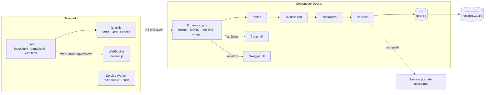

# Arquitectura

Rodando UTP es una PWA de HTML/CSS/JS vanilla servida por el mismo servidor Express que expone la API REST. Un solo contenedor Docker y un solo servicio en Render.

## Capas del backend (`backend/src`)

| Capa | Carpeta | Responsabilidad |
|---|---|---|
| Arranque | `server.js` | Migraciones + seed idempotentes y apertura del puerto |
| App | `app.js` | Middlewares globales, rutas, Swagger y estáticos |
| Rutas | `routes/` | Une URL + validación + permisos + controlador |
| Validación | `schemas/`, `middlewares/validate.js` | Esquemas zod; error 400 uniforme |
| Controladores | `controllers/` | Traducen HTTP ↔ servicios |
| Servicios | `services/` | Lógica de negocio (calculadora, reservas, raites, push, seguimiento en vivo) |
| Tiempo real | `realtime.js` | WebSocket `/api/vivo/ws`; salas por raite y fecha, posición y solicitudes |
| Datos | `db/` | Pool, migraciones SQL, seed |
| Transversal | `middlewares/` | auth JWT, errores, 404 |

## Decisiones de diseño

- **Sin sobreventa:** `POST /api/reservas` corre en una transacción con `SELECT … FOR UPDATE` sobre el raite; las solicitudes simultáneas se serializan. Hay una prueba de concurrencia (8 peticiones por 3 lugares → 3 éxitos).
- **Lugares libres calculados:** `libres = asientos − reservas confirmadas del día`; no se guarda un contador que pueda desincronizarse.
- **Errores uniformes:** `{ "error": { "code", "message", "details" } }`.
- **Seguridad:** helmet con CSP estricta, rate limit (global y más estricto en login/registro), bcrypt, JWT, solo correos `@utpuebla.edu.mx`.
- **Offline:** el cliente guarda cada GET en localStorage y el service worker usa red primero con respaldo en caché solo para GET públicos; nunca se cachean `/api/auth`, `/api/reservas`, `/api/admin`, `/api/push` ni `/api/vivo`.
- **Seguimiento en vivo:** estado del viaje por raite y fecha en `viajes`; la posición se difunde por WebSocket solo al conductor y a los participantes (`confirmada` o `pendiente`), caduca a los 90 s y las lecturas con precisión mayor a 30 m se rechazan. Aceptar una solicitud bloquea el raite y verifica asientos, así que tampoco hay sobreventa.
- **Migraciones y seed idempotentes:** pueden ejecutarse en cada arranque (con advisory lock para varias instancias).
- **Calculadora:** la fórmula vive en `services/calculadora.service.js`; el frontend tiene una copia de respaldo para uso sin conexión.
