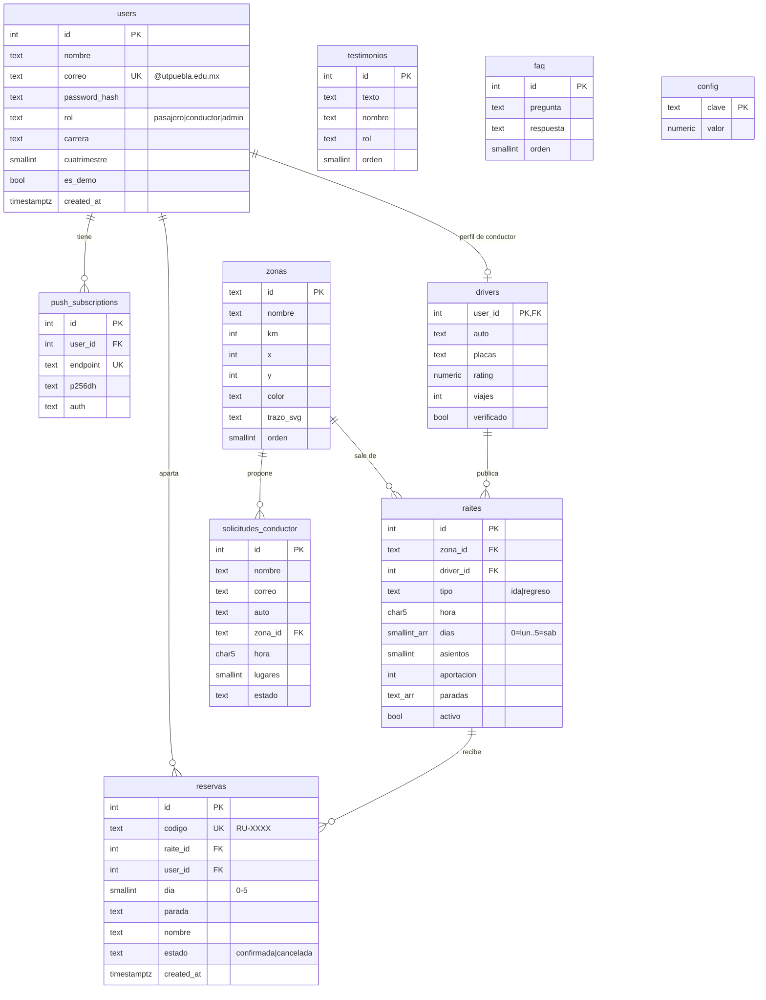

# Modelo de datos (PostgreSQL)

## Reglas de integridad

- `users.correo` es único y debe cumplir `^[^@\s]+@utpuebla\.edu\.mx$` (CHECK en la base).
- Índice único parcial `reservas(raite_id, user_id, dia) WHERE estado = 'confirmada'`: una persona no puede apartar dos veces el mismo raite el mismo día, pero sí volver a apartar tras cancelar.
- Borrar un raite elimina en cascada sus reservas; borrar un usuario elimina su perfil de conductor y sus suscripciones.
- `config` guarda los parámetros de la calculadora (`precioGasolina` 24.3, `co2PorLitro` 2.31, `tarifaUberKm` 9.5, `tarifaUberBase` 35, `pasajeTransporte` 12) y las cifras base del hero (`stats_*`, que la API no expone en `/api/config`).
- `users.es_demo` marca a los usuarios del seed para que no cuenten en `/api/stats`.

Las migraciones están en `backend/src/db/migrations/` y el registro de las aplicadas en la tabla `schema_migrations`.
